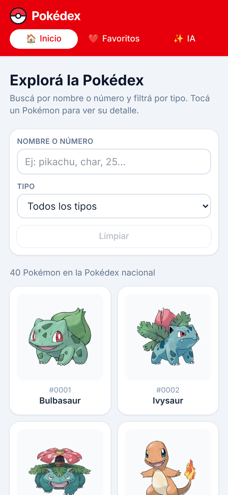
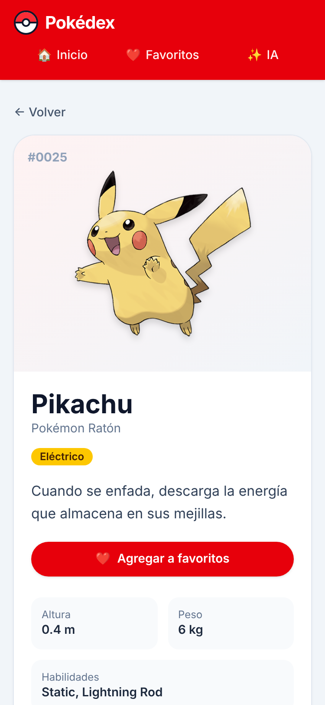
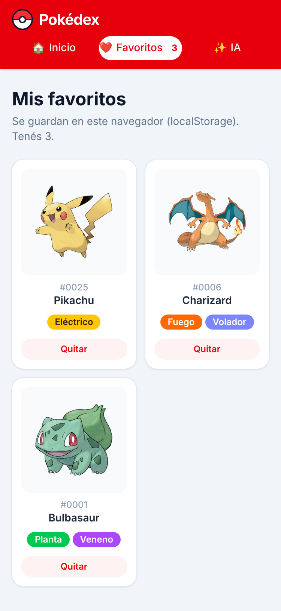
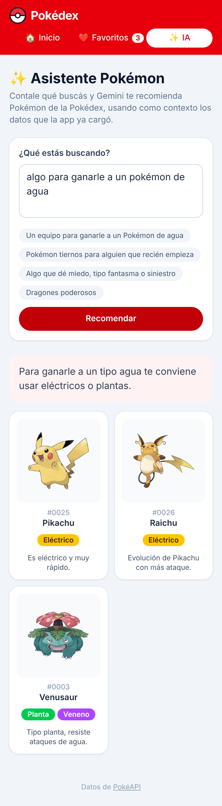
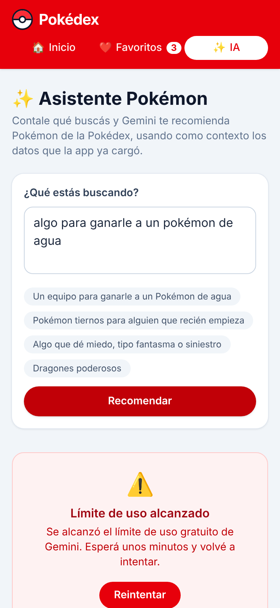
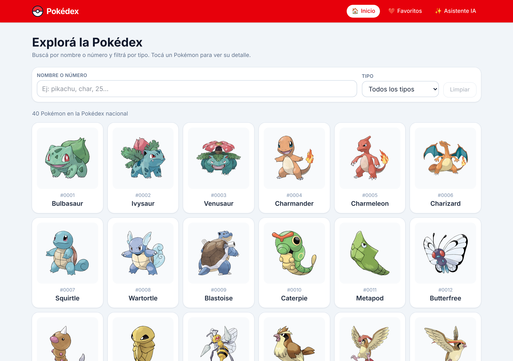
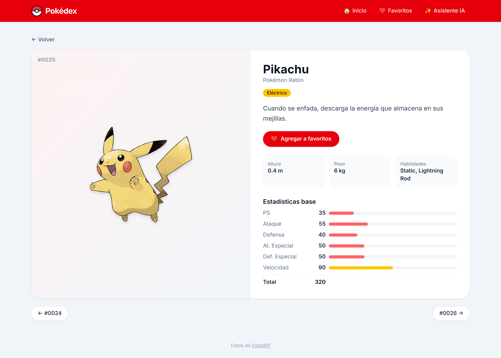
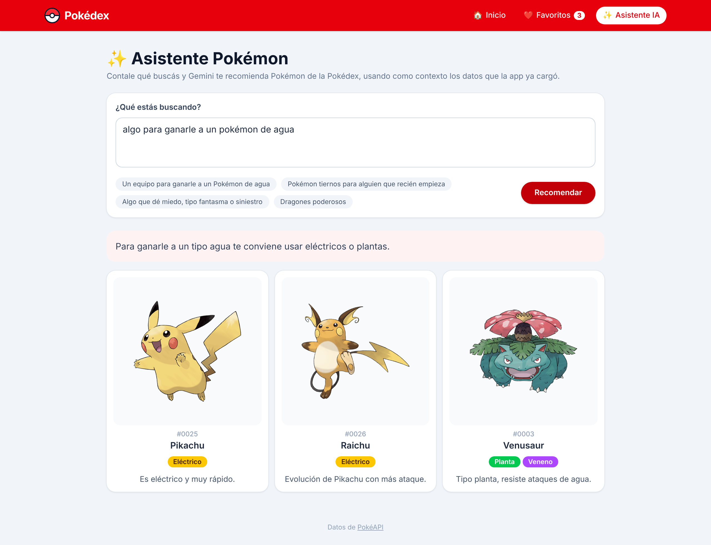

# Pokédex – Trabajo Práctico Segundo Parcial

Aplicación web hecha con **Vue 3 + Vite** que permite explorar Pokémon, buscarlos por nombre, filtrarlos por tipo, ver su detalle, guardarlos en favoritos y pedir recomendaciones a un **asistente con IA (Gemini mediante Firebase AI Logic)**.

## Integrantes

- _Nombre Apellido_ – _Legajo_
- _Nombre Apellido_ – _Legajo_
- _Nombre Apellido_ – _Legajo_

## Tema y API

- **Tema:** Pokémon
- **API:** [PokéAPI](https://pokeapi.co/) (pública, gratuita, sin API key)

| Requisito | Endpoint usado |
| --- | --- |
| Listado de elementos | `GET /pokemon?limit=1025` (Pokédex nacional) |
| Detalle de un elemento | `GET /pokemon/{id}` + `GET /pokemon-species/{nombre}` (descripción en español) |
| Categorías para el filtro | `GET /type` y `GET /type/{tipo}` |
| Imágenes | Sprites oficiales del repositorio `PokeAPI/sprites` |

> **Búsqueda:** PokéAPI no permite buscar por nombre parcial (solo por nombre exacto). Por eso la búsqueda **filtra sobre el listado ya cargado** con un `computed`, tal como permite la consigna. Se puede buscar por nombre parcial (`char`) o por número (`25`).

## Funcionalidades

| # | Requisito | Implementación |
| --- | --- | --- |
| 1 | Listado inicial con `fetch` | `src/services/pokeapi.js`, `HomeView.vue` |
| 2 | Barra de búsqueda | Input con **debounce** (350 ms) en `HomeView.vue` |
| 3 | Detalle en `/detalle/:id` | `DetailView.vue`: imagen, descripción, tipos, altura, peso, habilidades y estadísticas |
| 4 | Filtro por categoría | Selector de **tipo** (Fuego, Agua, Planta…) |
| 5 | Favoritos | Botón en el detalle, guardado en **localStorage**, ruta `/favoritos` para listarlos y quitarlos |
| 6 | Mobile first | Tailwind CSS. Probado a 375 px y adaptado con `sm:`, `md:` y `lg:` |
| 7 | Estados de carga y error | `LoadingState` y `ErrorState` (con botón **Reintentar**) en todas las pantallas que consumen datos |
| 8 | Firebase Hosting | `firebase.json` con *rewrite* a `index.html`, así funciona al recargar cualquier ruta |
| 9 | Módulo de IA | Asistente en `/asistente` (ver abajo) |
| 10 | Vue Router avanzado | Query params `?q=` y `?tipo=`, ruta comodín que redirige al inicio, enlace activo resaltado y `<Transition>` sobre `<RouterView>` |
| 11 | Computed, watch y ciclo de vida | `computed` para los resultados filtrados, `onMounted` para cargar datos, `watch` para la búsqueda y el filtro, debounce y **carga incremental** (de a 24, con botón y scroll infinito) |
| 12 | Animación de lista | `<TransitionGroup>` en favoritos al quitar y al **deshacer** (vuelve a agregarse) |

## Opción de IA elegida: Gemini con Firebase AI Logic

En la ruta **`/asistente`** el usuario escribe un pedido en texto libre (por ejemplo, _"un equipo para ganarle a un Pokémon de agua"_) y Gemini recomienda entre 3 y 6 Pokémon con una explicación breve de cada uno.

- Se usa el SDK de Firebase (`firebase/ai`) con el backend `GoogleAIBackend` (Gemini Developer API). Ver `src/services/firebase.js`.
- **La API key de Gemini no está en el código:** la administra Firebase. En el `.env` solo va la configuración pública de la app web de Firebase.
- **Contexto:** se envían al modelo los Pokémon que la app ya cargó (nombre y tipos). Se usa una respuesta JSON con esquema (`responseSchema`), y solo se muestran los Pokémon que existen en los datos cargados.
- **Cuota del plan gratuito:** si Gemini responde con error 429 / `RESOURCE_EXHAUSTED`, la app muestra el mensaje _"Se alcanzó el límite de uso gratuito de Gemini. Esperá unos minutos y volvé a intentar."_ con opción de reintentar.
- El proyecto de Firebase usa el plan **Spark (gratuito)**, sin cuenta de facturación vinculada.

## Instalación y ejecución

Requisitos: Node.js 22.18 o superior.

```bash
npm install
cp .env.example .env   # completar las variables (ver abajo)
npm run dev
```

Otros comandos:

```bash
npm run build     # compila en dist/
npm run preview   # sirve la versión compilada
npm run lint      # oxlint + eslint
```

## Variables de entorno

Copiar `.env.example` a `.env` y completar con los datos de la app web de Firebase:

| Variable | Dónde se obtiene |
| --- | --- |
| `VITE_FIREBASE_API_KEY` | Consola de Firebase › ⚙️ Configuración del proyecto › Tus apps › App web |
| `VITE_FIREBASE_AUTH_DOMAIN` | Ídem |
| `VITE_FIREBASE_PROJECT_ID` | Ídem |
| `VITE_FIREBASE_STORAGE_BUCKET` | Ídem |
| `VITE_FIREBASE_MESSAGING_SENDER_ID` | Ídem |
| `VITE_FIREBASE_APP_ID` | Ídem |
| `VITE_GEMINI_MODEL` | Opcional. Modelo de Gemini (por defecto `gemini-3.5-flash-lite`) |

El archivo `.env` está en `.gitignore`. Sin estas variables, la app funciona igual y solo el asistente muestra un aviso de que no está configurado.

### Configurar Firebase (una sola vez)

1. Crear un proyecto en <https://console.firebase.google.com/>. Queda en el plan **Spark**; **no** vincular una cuenta de facturación.
2. Registrar una **app web** (`</>`) y copiar los valores de `firebaseConfig` al `.env`.
3. En el menú **AI Logic** (Firebase AI Logic), hacer clic en **Comenzar** y elegir **Gemini Developer API**. Firebase genera y administra la API key de Gemini.
4. Instalar la CLI y desplegar:

```bash
npm install -g firebase-tools
firebase login
firebase use --add   # elegir el proyecto creado
npm run build
firebase deploy --only hosting
```

## URL pública (Firebase Hosting)

🔗 **https://TU-PROYECTO.web.app**

## Capturas

### Versión móvil (375 px)

| Inicio | Detalle | Favoritos | Asistente IA |
| --- | --- | --- | --- |
|  |  |  |  |

Mensaje al alcanzar la cuota de la IA:



### Versión escritorio





## Estructura del proyecto

```
src/
├── App.vue                  # Layout, navegación y transición entre rutas
├── router/index.js          # Rutas, redirección "no encontrado"
├── services/
│   ├── pokeapi.js           # Llamadas a PokéAPI con fetch (con caché en memoria)
│   └── firebase.js          # Firebase + Gemini (Firebase AI Logic)
├── composables/
│   ├── usePokemonList.js    # Estado compartido del listado y los tipos
│   └── useFavorites.js      # Favoritos en localStorage
├── components/              # PokemonCard, TypeBadge, LoadingState, ErrorState
├── utils/                   # debounce y traducciones al español
└── views/                   # Home, Detail, Favorites, Assistant
```
